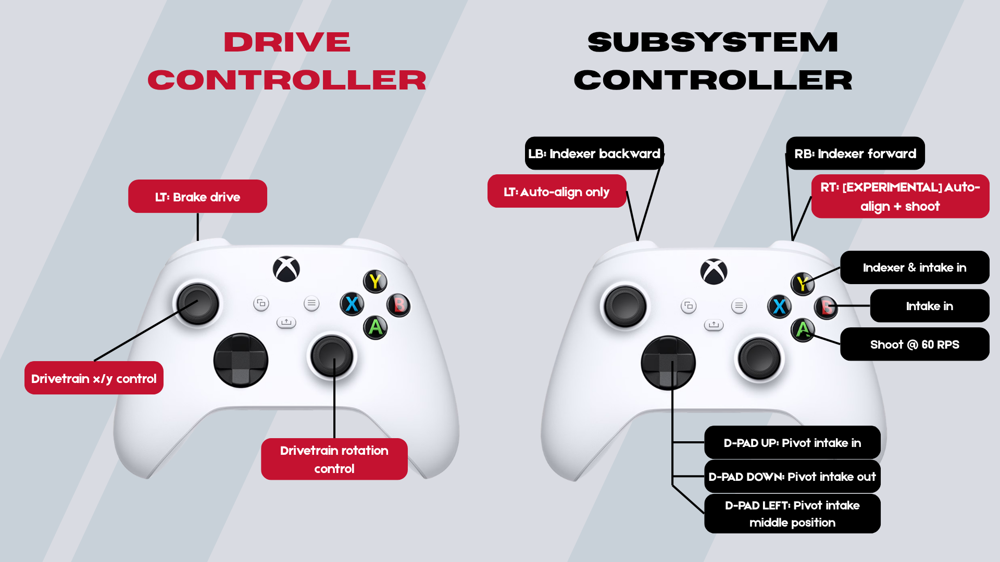

# Branch for my version of the robot code

Was used for the SoCal competition

**Currently based on WPILIB 2027 Alpha 7**

**Vendor Dependencies:**
* **Commands v2**
* **CTRE-Phoenix (v6)**
* **LimelightLib 2**
* **PathplannerLib**
* **REVLib**

## Features

Anything below with a checkmark [✅] has been tested on the robot and confirmed to work.

Added:
* Odometry [✅]
* Simulation [✅]
* Pathplanner [✅]
* Odometry-based auto-align [✅]
* Odometry-based auto-distance [✅]
* Elastic dashboard [✅]
* Dynamic PID tuning [✅]
* Limelight visionary pose estimation [✅]

Post competition additions:
* Pathfinding 
* AdvantageScope 3D simulation and tuning

## Important

(The branch Ethan-Drivebase is the original branch and the branch before I re-added the subsystems back onto the drivebase.)

## Resources

[List of the 12 autos here](/image-assets/autos/README.md)

[User guide](/image-assets/start-poses/README.md)

## Controls

    

